# BarPulse 端到端验证报告

- 时间：2026-10-30 11:45:01
- 机器：Apple M5 Pro · 18 核 CPU · 20 核 GPU · 64 GB · macOS 27.0.1
- 截图来源：Cua Driver 的 ScreenCaptureKit 整屏录制（真实屏幕像素，非离屏渲染）
- 交互方式：通过菜单栏 (MenuBarAgent) 的辅助功能树按下 BarPulse 状态栏项，与鼠标点击走同一路径；透明度滑块和面板边缘用直接投递给 BarPulse 的鼠标事件 (CGEvent) 点击、拖动，不移动系统指针
- 只在 Cua Driver 录制的副显示器上操作：仪表盘、设置窗口和背景板都不出现在主显示器上，也不抢键盘焦点
- 仪表盘截图时在面板后面铺一张系统自带壁纸 (Sonoma)，透过玻璃看到的是固定画面而不是当时打开的窗口

## 指标交叉校验

| 结果 | 检查项 | BarPulse | 参考值 |
|---|---|---|---|
| ✅ | CPU 总占用 vs top (6 秒均值) | 9.8% | top 9.4%，8 / 6 个 1 秒窗口 |
| ✅ | 内存已使用 vs vm_stat | 47.34 GB | vm_stat 47.34 GB |
| ✅ | 内存总量 vs hw.memsize | 64.00 GB |  |
| ✅ | 交换区 vs vm.swapusage | 1.27 GB | sysctl 1.27 GB |
| ✅ | 网络累计接收 vs netstat -ibn | 226.27 GB | netstat 226.27 GB |
| ✅ | 主网络接口 | Wi-Fi (en0)，本机 IP 已获取 |  |
| ✅ | GPU 统计可读 (IOAccelerator) | 11%，显存占用 1.42 GB | ioreg 0% |
| ✅ | 温度传感器读数合理 (15–110°C) | cpu=56.6°C，gpu=54.1°C，memory=55.1°C，soc=52.3°C，ssd=41.0°C，battery=35.0°C |  |
| ✅ | 风扇转速 (SMC) | 风扇1 2315 RPM (范围 2317–7826)，风扇2 2504 RPM (范围 2317–7826) |  |

## 负载响应测试

| 结果 | 检查项 | BarPulse | 参考值 |
|---|---|---|---|
| ✅ | CPU 满载 (18 个 yes 进程) | 97.7% |  |
| ✅ | 满载后 CPU 温度上升 | 56.6°C → 67.0°C |  |
| ✅ | GPU 负载 (Metal 计算着色器) | 100% | ioreg 100% |
| ✅ | 下载速率 vs netstat 同窗口增量 | 均值 8.47 MB/s，峰值 10.17 MB/s | netstat 均值 8.52 MB/s，12 个 1 秒窗口，偏差 2.0% |

## 界面端到端

| 结果 | 检查项 | BarPulse | 参考值 |
|---|---|---|---|
| ✅ | 状态栏项出现在菜单栏 (MenuBarAgent AX) | pid 32434 |  |
| ✅ | 打开仪表盘不抢前台应用和键盘焦点 | 打开前后前台应用：Ghostty → Ghostty |  |
| ✅ | 点击状态栏项打开仪表盘，面板挂在状态栏项正下方 | 面板 660×841，中心 x=3098，距菜单栏 5 pt | 状态栏项中心 x=3098 |
| ✅ | BarPulse 自身开销 (面板关闭，top 12 秒均值) | CPU 0.93%，内存 41 MB | 阈值 CPU < 3%，内存 < 100 MB |
| ✅ | 负载期间仪表盘 CPU 读数 (界面文本) | 65% | dump 58% |
| ✅ | 仪表盘内存读数与采样一致 (界面文本) | 46.8 GB | dump 46.8 GB |
| ✅ | 仪表盘网络接口 (界面文本) | Wi-Fi · en0 |  |
| ✅ | 仪表盘包含 5 类指标卡片 | CPU / GPU / 内存 / 网络 / 温度与风扇 |  |
| ✅ | BarPulse 自身开销 (面板打开，top 12 秒均值) | CPU 8.50%，内存 139 MB | 阈值 CPU < 12%，内存 < 250 MB |
| ✅ | 点击「设置」打开设置窗口，出现在状态栏项所在的显示器 | 460×896，位于 (2792, 392) |  |
| ✅ | 设置切换「单行图标」样式，菜单栏即时生效 | 状态栏项中心 3098 → 3046 | screenshots/06-menubar-inline-zoom.png |
| ✅ | 设置关闭「彩色指示条」，菜单栏即时生效 | colorful = 0 | screenshots/07-menubar-monochrome-zoom.png |
| ✅ | 关闭设置窗口 | 已关闭 |  |
| ✅ | 设置切换深色仪表盘 | appearance = dark | screenshots/05-dashboard-dark.png |

## 面板透明度与大小

| 结果 | 检查项 | BarPulse | 参考值 |
|---|---|---|---|
| ✅ | 默认大小为内容的理想尺寸 | 660×841 | 宽 660 pt，与改版前一致 |
| ✅ | 点击仪表盘底栏滑块调节透明度 | dashboardTransparency = 0.595，底栏显示 60% | 目标 60% |
| ✅ | 背后的壁纸透过面板显现 (像素对比) | 面板区域与纯背景的平均色差 96.0 → 47.3 | 透明度 0% → 60%，越小越接近背景 |
| ✅ | 拖动右下角放大面板 | 660×841 → 880×981，左上角不动 | 拖动 +220, +140 |
| ✅ | 新尺寸写入偏好设置 | 880 × 981 |  |
| ✅ | 拖动左边缘加宽，右边缘不动 | 880×981 → 1000×981 |  |
| ✅ | 拖动下边缘缩小，停在内容的最小高度 | 1000×981 → 1000×804，再上拖 150 pt 仍为 804 | 最小高度小于默认的 841 |
| ✅ | 拖动右边缘缩小，停在最小宽度，左边缘不动 | 1000×804 → 640×804 | 最小宽度 640 |
| ✅ | 最小尺寸下内容完整 (界面文本) | 5 类卡片、透明度滑块、底栏按钮都在 |  |
| ✅ | 关闭后重新打开，保持上次的大小 | 640×804 | 上次 640×804 |
| ✅ | 滑块调回 0% | dashboardTransparency = 0 |  |
| ✅ | 从仪表盘打开设置窗口 | 已打开 |  |
| ✅ | 设置窗口显示当前面板大小与透明度 | 面板大小 640 × 804，透明度 0% |  |
| ✅ | 设置里「恢复默认」后回到默认大小 | 660×841 | 默认 660×841 |

## 截图

### 菜单栏状态项放大

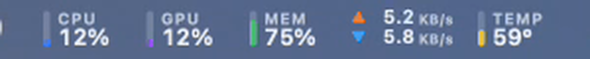

### 仪表盘（图表含一次负载事件）

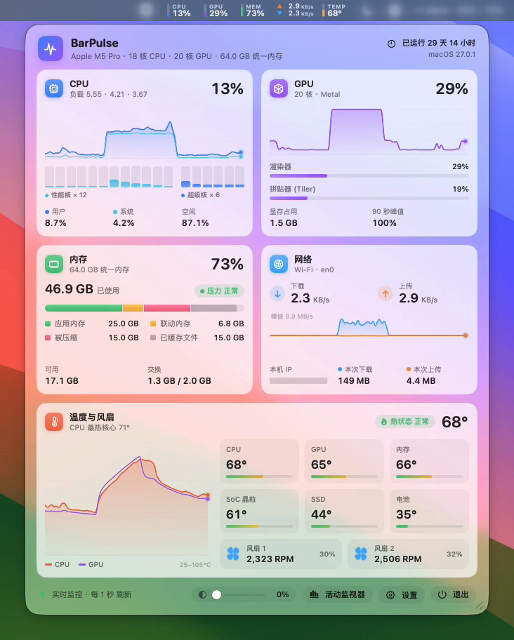

### CPU + GPU + 网络同时加压时的仪表盘

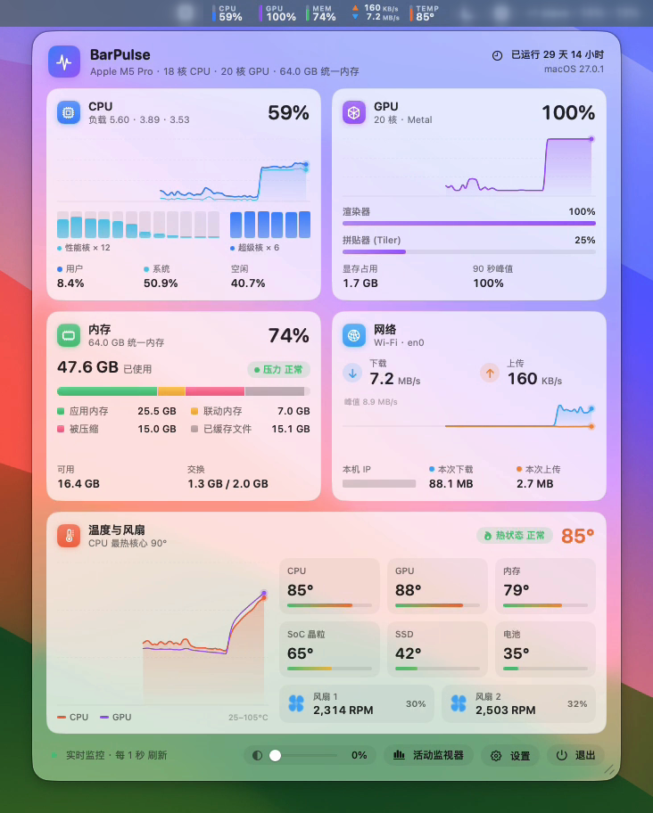

### 加压时的菜单栏

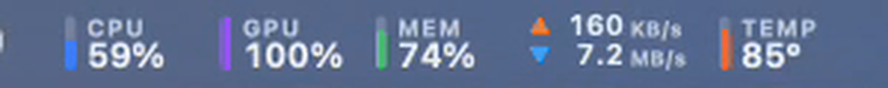

### 设置窗口（含菜单栏实时预览）

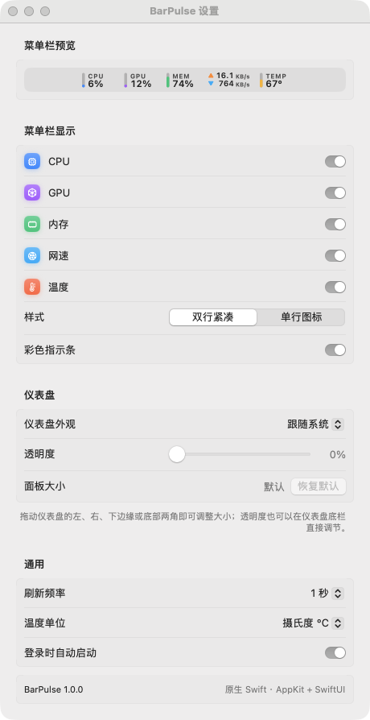

### 深色外观

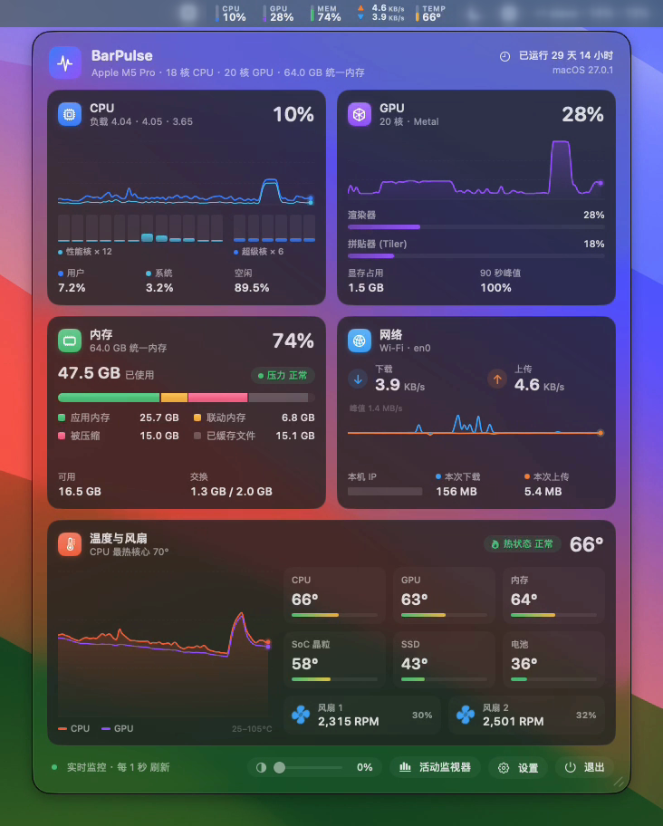

### 单行图标样式

### 单色样式

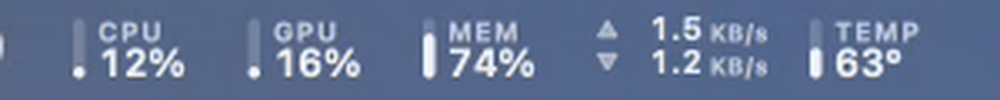

### 透明度 60%（底栏滑块拖动后）

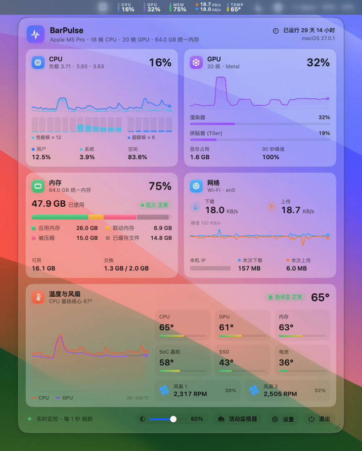

### 拖动右下角放大后的仪表盘（图表随之变大）

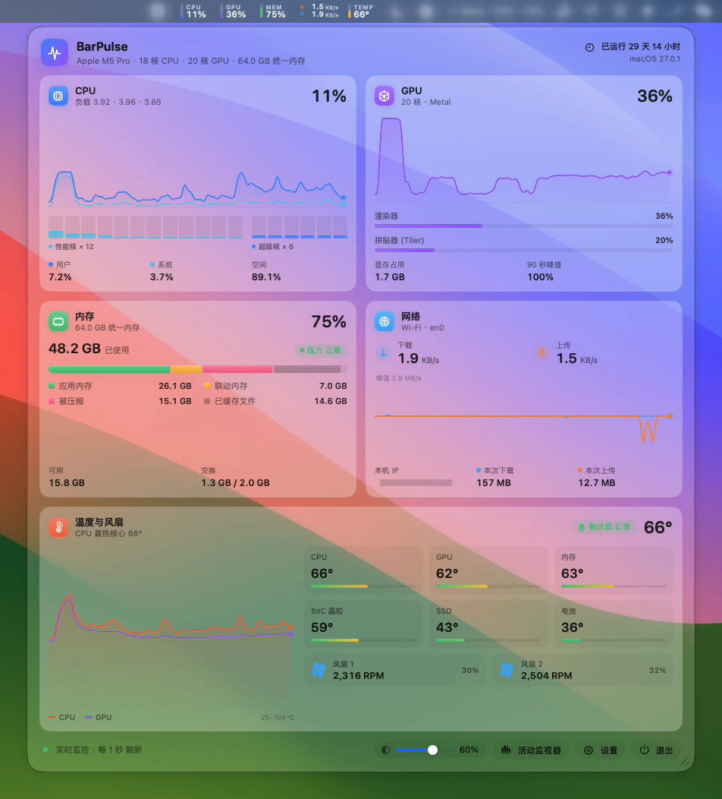

### 最小尺寸

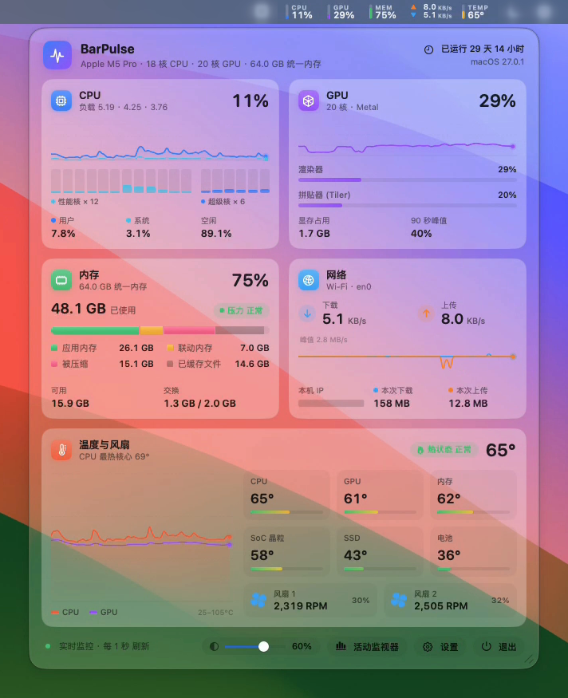

### 调节透明度 0% → 90% → 60%

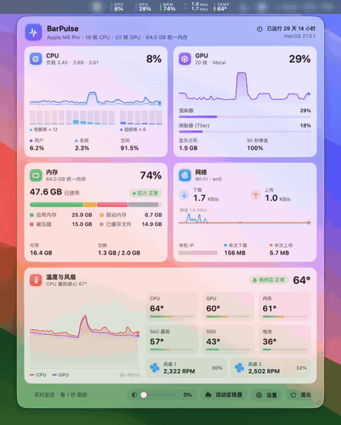

### 拖动右下角调整大小

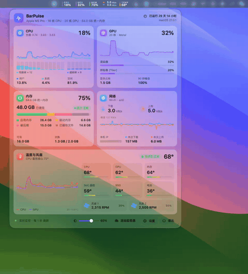

实时刷新动图：[live-menubar.gif](screenshots/live-menubar.gif) · 视频：[live-dashboard.mp4](screenshots/live-dashboard.mp4)
